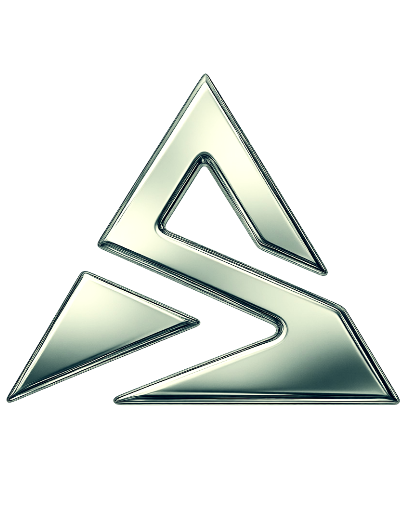

<div align="center">



# STACK BLACKZADA `<SOFTWARE_HOUSE />`

**Ideias viram código. Código vira resultado.**


</div>

---

## 📖 Sobre

Landing page oficial da **Stack Blackzada**, uma equipe de desenvolvimento que cria sites, lojas virtuais, sistemas, apps e automações para empresas que querem crescer na internet.

## ✨ Recursos

- 🎬 **Hero pinned** com animação de scroll (zoom + rotação da logo) via GSAP ScrollTrigger
- 🔦 **Glass cards** com efeito spotlight que segue o mouse e tilt 3D no card "Quem Somos"
- 🔢 **Contadores animados** na seção de métricas
- 🌗 **Modo claro / escuro** com persistência (`localStorage`) e respeito ao tema do sistema
- 🌍 **Multi-idioma** PT / EN / ES com persistência
- 📱 **Responsivo**, com otimizações para celular (blur reduzido, hover apenas com mouse)
- 🧭 **Navbar inteligente**, que esconde ao rolar para baixo e reaparece ao subir

## 🧰 Stack

| Tecnologia | Uso |
| --- | --- |
| [React](https://react.dev) | Componentização da interface |
| [Vite](https://vitejs.dev) | Dev server e build |
| [Tailwind CSS 3](https://tailwindcss.com) | Estilização utilitária |
| [GSAP + ScrollTrigger](https://gsap.com) | Animações de scroll |
| Outfit & Space Grotesk | Tipografia (Google Fonts) |

## 🗂️ Estrutura

```text
landpage-stack/
├── public/                    # Assets estáticos (logo e favicon)
├── legacy/home.html           # Versão original em HTML único (referência)
├── src/
│   ├── components/            # Navbar, Hero, About, Metrics, Services, Workflow, Contact, Footer
│   ├── hooks/
│   │   ├── useAnimations.js   # GSAP, spotlight/tilt, navbar, contadores
│   │   ├── useLanguage.js     # Estado e função de tradução
│   │   └── theme.js           # Modo claro/escuro
│   ├── i18n/translations.js   # Dicionário PT / EN / ES
│   ├── App.jsx
│   ├── main.jsx
│   └── index.css              # Estilos globais e efeitos customizados
├── index.html
├── tailwind.config.js         # Paleta de cores e fontes da marca
├── postcss.config.js
└── vite.config.js
```

## 🎨 Identidade visual

| Token | Cor |
| --- | --- |
| `brand-accent` | `#20E3BD` |
| `brand-subtle` | `#124844` |
| `brand-dark` | `#08171A` |
| `brand-light` | `#DDF9F6` |
| `darkbg-main` | `#060F11` |

## 🚀 Como rodar

Requer [Node.js](https://nodejs.org) 18+.

```bash
git clone https://github.com/StackBlackzada/landpage-stack.git
cd landpage-stack
npm install
npm run dev
```

| Comando | Descrição |
| --- | --- |
| `npm run dev` | Servidor de desenvolvimento |
| `npm run build` | Build de produção em `dist/` |
| `npm run preview` | Pré-visualiza o build |

## 🌍 Adicionando um idioma

1. Adicione um novo objeto em [`src/i18n/translations.js`](src/i18n/translations.js) com as mesmas chaves.
2. Inclua a `<option>` no seletor em [`Navbar.jsx`](src/components/Navbar.jsx).

## 📬 Contato

- ✉️ [stackblackzada@gmail.com](mailto:stackblackzada@gmail.com)
- 📸 [@stack.blackzada](https://instagram.com/stack.blackzada)

---

<div align="center">© 2026 Stack Blackzada. All rights reserved.</div>
